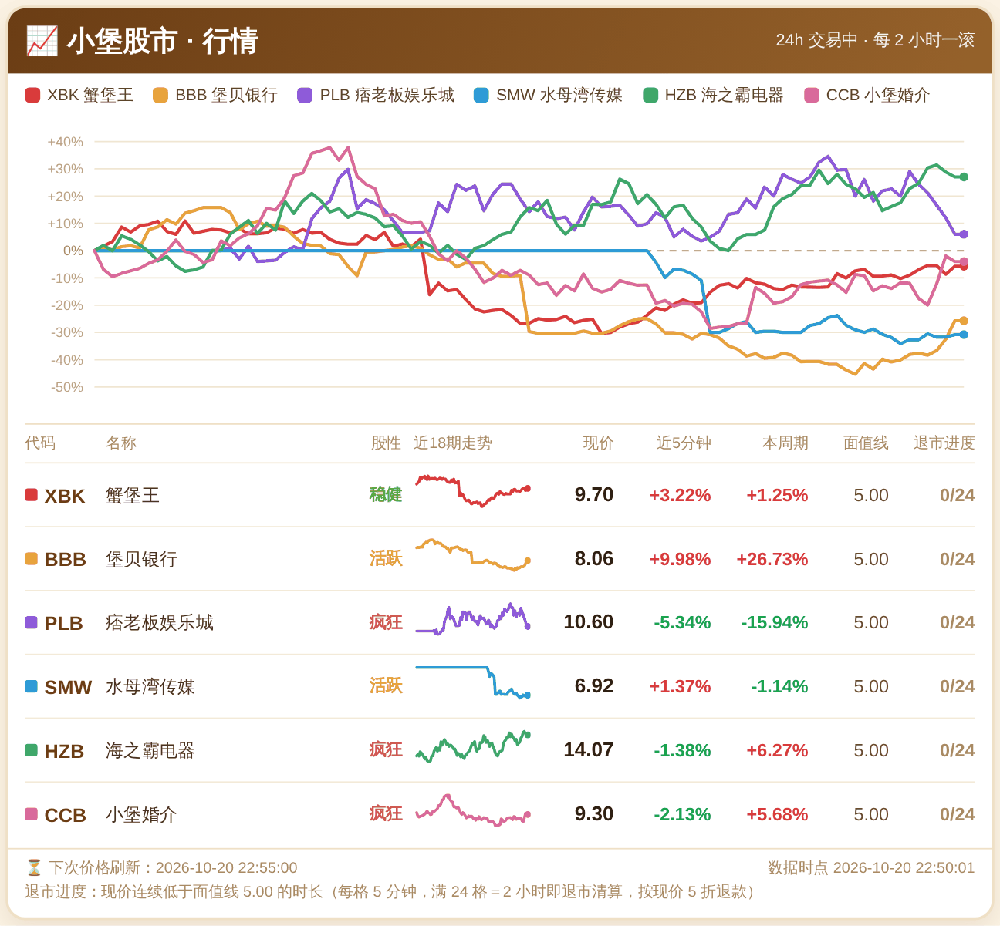
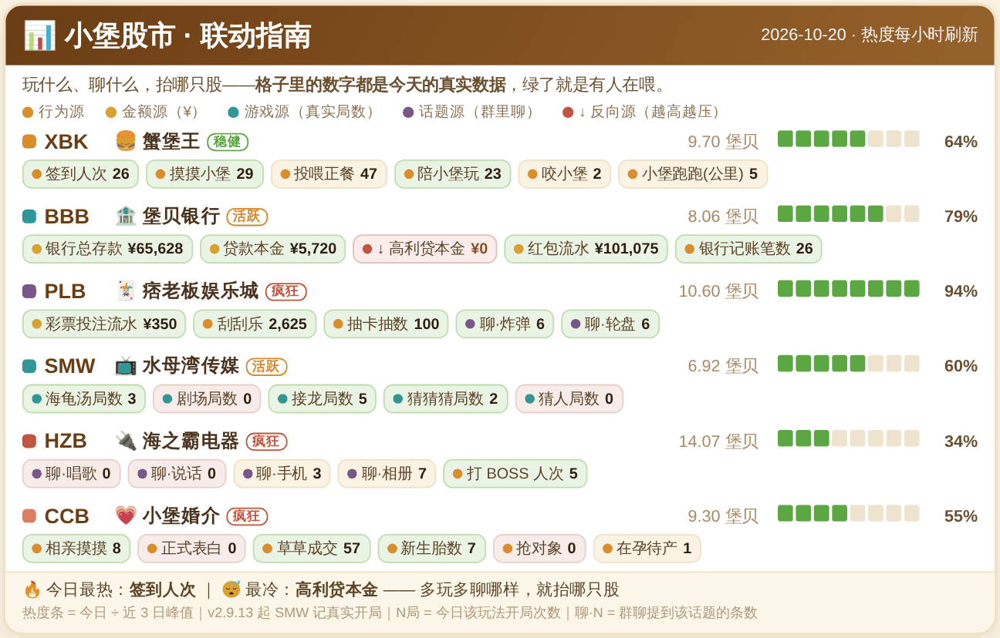

# 群聊股市 · AstrBot 插件

**股价不靠掷骰子，靠群友的真实行为当基本面。**

群友签到、摸摸、玩游戏、存钱、开黑……这些行为会喂给六只股票，让它们涨或跌。
零 LLM、零 token、零外部依赖，装进 AstrBot 就能跑。

> 默认题材是海绵宝宝梗（蟹堡王 / 堡贝银行 / 痞老板娱乐城 / 水母湾传媒 / 海之霸电器 / 小堡婚介），
> 事件文案也全是玩梗。**这些纯属彩蛋，可以随意替换** —— 见 [改题材](#改题材)。

## 它跟「随机涨跌」的股市插件差在哪

| | 常见做法 | 本插件 |
|---|---|---|
| 涨跌来源 | 每 tick 摇一次随机数 | 群友行为联动（主）+ 噪声（低）+ 随机事件 + 黑天鹅 |
| 因果可感知 | 无 | 群里播报「今天谁喂了哪只股」，群友能看懂自己做了什么 |
| 依赖 | 常需 LLM 判情绪 | 零 LLM、零 token，纯本地计算 |
| 数据源 | 写死 | `SOURCES` 适配器，一个指标一个函数，换机器人只改这一块 |

## 截图

**行情卡** —— 发 `小堡股市：行情`



**联动卡** —— 发 `小堡股市：联动`。格子里每个数字都是当天的真实计数，数字变绿说明有人在喂这只股



> 卡片由 AstrBot 的 `html_render` 渲染。没有 Playwright 环境时会自动降级为纯文字，功能不受影响。

## 快速开始

**方式一：插件市场**（AstrBot ≥ 4.5）
WebUI → 插件 → 从仓库安装，填 `https://github.com/Percent-51/astrbot_plugin_stock_demo`

**方式二：手动**

```bash
cd <AstrBot 根目录>/data/plugins
git clone https://github.com/Percent-51/astrbot_plugin_stock_demo
```

然后在 WebUI 插件页重载，或重启 AstrBot。

**配置群号**（二选一）：

- WebUI → 插件配置 → `group_id` 填你的群号（推荐）
- 或改 `main.py` 顶部 `GROUP_ID = "123456789"`

> ⚠️ **群号没填 = 插件完全静默**。`on_message` 里有 `if gid != self.group_id: return`，
> 私聊和别的群一律不响应。启动日志看到 `[StockDemo] 还没填群号！` 就是这个问题。

重启后群里发 `小堡股市：规则`，有回就通了。

## 指令

| 指令 | 作用 |
|---|---|
| `小堡股市：行情` | 行情卡（6 只股 + 涨跌幅 + 股性 + 退市进度） |
| `小堡股市：联动` | 联动卡（今天各玩法喂了哪只股多少、热度条） |
| `小堡股市：资讯` | 最近 5 次随机事件回放 |
| `小堡股市：买 XBK 200` | 买入 |
| `小堡股市：卖 XBK 100` | 卖出 |
| `小堡股市：持仓` | 持仓明细 + 浮动盈亏 |
| `小堡股市：排行` | 总资产榜 |
| `小堡股市：排行 今日` | 今日收益率榜 |
| `小堡股市：规则` | 规则说明 |

前缀可省：`买 XBK 200` 也能用。想换前缀改 `main.py` 的 `CMD_PREFIXES`。

手续费 0.3% 双向，全部进金库，每晚 22:05 按 XBK 持股分红给股东。

## ⚠️ 装完联动是 0，这是正常的

行情靠噪声 + 随机事件 + 黑天鹅自己就会动，但**联动默认是空的** —— 插件不知道你的机器人
有哪些玩法、数据存在哪。要你自己接：

```python
# main.py 里搜 SOURCES = {
SOURCES = {
    "checkin":  lambda day, gid: _read_json(DATA / "checkin.json").get(day, 0),
    "game_soup": lambda day, gid: _read_json(DATA / "games.json")[gid]["day_counts"][day]["soup"],
    "bank_dep":  _zero,   # 没这个玩法就留空函数
    ...
}
```

- 每个指标一个函数，签名固定 `fn(day: str, gid: str) -> float`，返回**当日累计计数**
- 抛异常会被兜住按 0 处理，不会让行情卡崩掉
- 没接的指标留 `_zero` 就行
- 接完发 `小堡股市：联动`，卡上的数字应该等于你函数返回的值

完整接法、32 个指标的含义、量纲与平滑规则见 **[docs/移植指南.md](docs/移植指南.md)**。

## 改题材

六只股在 `main.py` 的 `STOCKS` 里，一行一只：

```python
"XBK": {"name": "蟹堡王", "vol": 1.0, "limit": 0.22, "sources": [
    ("checkin", 0.25), ("pet", 0.20), ("fed_meals", 0.20), ("play", 0.15),
    ("bite", 0.10), ("run_km", 0.10)]},
```

- `name` 随便改；`vol` 是波动倍率（越大越疯）；`limit` 是单周期涨跌停
- `sources` 里是 `(指标名, 权重)`，权重决定这个玩法对股价的影响占比
- 事件文案在 `EVENTS`（每股 12 条，正负各 6）和 `BLACK_SWAN_EVENTS`（每股 4 条，正负各 2）
- 改完记得：**加/减事件条目不用动别的**，但**改股数或代码要同步 `STOCKS` 和两个事件池的键**

### 调手感：联动怎么换算成涨跌

`main.py` 顶部三个常数决定「群里玩多少 → 股价涨多少」，一般只动这三个：

| 常数 | 默认 | 作用 |
|---|---|---|
| `NEUTRAL_RATIO` | `0.78` | 中性线。`ratio = 今日累计 ÷ 近 3 日同时刻均值`，**玩到平时的 78% 就止跌，80% 起涨** |
| `SENSE` | `0.22` | 联动灵敏度。越大，玩得多涨得越凶 |
| `NOISE_SIGMA` | `0.07` | 纯噪声。**这是「看不出规律」的元凶** —— 调大就会盖住联动 |

换算关系（以 XBK `vol=1.0` 为例，5 分钟 tick，一周）：

| 群里活跃度 | 股价 |
|---|---|
| 冷清（平时的 70%） | −5% |
| 照常（平时的 100%） | **+7%** |
| 多玩 30% | +20% |
| 多玩 60% | +35% |

不想要「照常玩也涨」，把 `NEUTRAL_RATIO` 调回 `1.0` 即可（照常 = 持平）。
觉得太温和就加 `SENSE`，觉得太疯就先加 `NOISE_SIGMA` 反而没用 —— 那是加抖动，不是加趋势。

## 目录结构

```
astrbot_plugin_stock_demo/
├── main.py                 全部逻辑（单文件）
├── metadata.yaml           插件元信息
├── _conf_schema.json       可视化配置（只有 group_id）
├── docs/
│   ├── 移植指南.md          接数据源的完整教程
│   └── images/             截图
├── tests/
│   └── 冒烟回归.py          89 条断言，不需要 AstrBot 环境
├── CHANGELOG.md
└── LICENSE
```

## 自测

改完代码跑一下，不需要装 AstrBot：

```bash
python tests/冒烟回归.py
# ==== 89 PASS / 0 FAIL ====
```

覆盖：结构残留 / 数据源适配器 / 货币接口 / 定价 20 tick / 交易与手续费 / 分红 / 退市 / 文本输出 / 路由。

## 已知限制

- **单群**：一个实例只服务一个群。多群需要把 `self.group_id` 改成集合判断，见移植指南 §6
- **联动源要自己接**：不接就只有噪声行情
- **卡片需要 Playwright**：没有就降级纯文字
- **运行时数据落在 `data/plugin_data/<插件名>/`**，不在插件目录，升级不会丢

## License

[MIT](LICENSE)
